# Data Engineering (DE) Major Project — Comprehensive Database Submission
**Project Title:** RajBhasha AI (राजभाषा AI) — Intelligent Bilingual Localization Platform  
**Demonstration Portal:** National Electricity Services Portal (Ministry of Power Prototype)  
**Database Engine:** PostgreSQL 16+ (Object-Relational DBMS)  
**Object-Relational Mapping (ORM):** Prisma ORM 6  
**Folder:** `DE/` (Mandatory Project Submission Deliverable)

---

## Table of Contents
1. [Project Objective & System Architecture](#1-project-objective--system-architecture)
2. [Database Selection & Technical Justification](#2-database-selection--technical-justification)
3. [Entity-Relationship (ER) Modeling & Data Architecture](#3-entity-relationship-er-modeling--data-architecture)
   * 3.1 [Entity-Relationship (ER) Diagram (Crow's Foot)](#31-entity-relationship-er-diagram-crows-foot)
   * 3.2 [Entity Dictionary & Attribute Specifications](#32-entity-dictionary--attribute-specifications)
   * 3.3 [Cardinalities & Relationship Matrix](#33-cardinalities--relationship-matrix)
   * 3.4 [Resolution of Many-to-Many (M:N) Relationships](#34-resolution-of-many-to-many-mn-relationships)
4. [Database Normalization Analysis](#4-database-normalization-analysis)
   * 4.1 [Potential Anomalies in Unnormalized Systems](#41-potential-anomalies-in-unnormalized-systems)
   * 4.2 [1NF, 2NF, 3NF, and BCNF Mathematical Proofs](#42-1nf-2nf-3nf-and-bcnf-mathematical-proofs)
   * 4.3 [Functional Dependencies (FDs)](#43-functional-dependencies-fds)
   * 4.4 [Deliberate Denormalization & Engineering Trade-offs](#44-deliberate-denormalization--engineering-trade-offs)
5. [Database Implementation](#5-database-implementation)
   * 5.1 [DDL & Constraint Architecture](#51-ddl--constraint-architecture)
   * 5.2 [Sample Seed Data Overview](#52-sample-seed-data-overview)
6. [Project-Specific SQL Queries & Execution Outputs (12 Queries)](#6-project-specific-sql-queries--execution-outputs)
7. [Database & Backend Integration Evidence](#7-database--backend-integration-evidence)
   * 7.1 [Prisma Client Integration Flow](#71-prisma-client-integration-flow)
   * 7.2 [Backend Controller Implementation Snippets](#72-backend-controller-implementation-snippets)
   * 7.3 [End-to-End Data Verification](#73-end-to-end-data-verification)
8. [Data Integrity & Performance Engineering](#8-data-integrity--performance-engineering)
   * 8.1 [Declarative Constraint Enforcement](#81-declarative-constraint-enforcement)
   * 8.2 [Indexing Strategy & Rejected Indexes](#82-indexing-strategy--rejected-indexes)
   * 8.3 [100x Scalability Blueprint](#83-100x-scalability-blueprint)

---

## 1. Project Objective & System Architecture

### 1.1 Objective
The primary objective of **RajBhasha AI** is to solve the digital language divide across India's public sector by delivering dynamic, reversible, and context-aware localization of government web portals into official administrative Hindi (राजभाषा).

As part of the **Data Engineering (DE)** curriculum, this project demonstrates the end-to-end practical application of relational database concepts:
* Robust schema modeling supporting multi-tenant portal management.
* Strict ACID-compliant storage for legal translation audits.
* Complete elimination of data redundancy through normalization up to **Boyce-Codd Normal Form (BCNF)**.
* High-performance querying, composite indexing, and transactional integrity.

### 1.2 System Layer Architecture

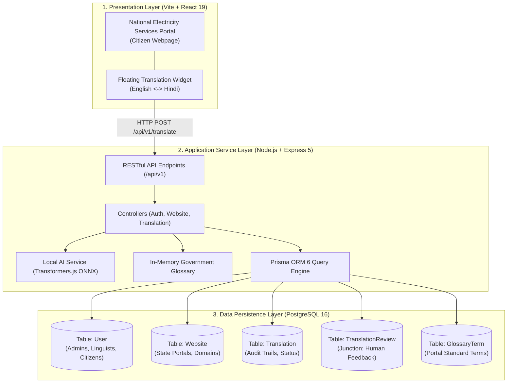

---

## 2. Database Selection & Technical Justification

### 2.1 Database Selected: PostgreSQL 16+ (Object-Relational DBMS)

We evaluated both **Relational (PostgreSQL)** and **Document-Oriented (MongoDB)** paradigms. Based on the specific data characteristics and operational workflows of government portal localization, **PostgreSQL was selected**.

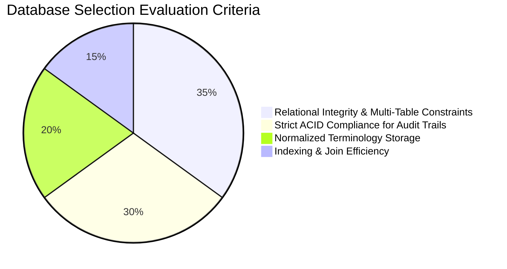

### 2.2 Justification Based on Data Nature and Access Patterns

1. **Structured Data with Predefined Schemas:**
   Our domain entities—Users, Registered Websites, Persistent Translations, Reviews, and Glossaries—have well-defined, rigid structural properties. We enforce PostgreSQL native enumerations:
   * `Role`: `'ADMIN'`, `'REVIEWER'`, `'USER'`
   * `TranslationStatus`: `'MACHINE'`, `'APPROVED'`, `'REJECTED'`
   Using a schema-less NoSQL database would require expensive runtime application assertions to prevent corrupt data entry.

2. **Read/Write Access Patterns:**
   * **Read Workload:** High-concurrency reads where citizen pages fetch portal-specific glossary terms and verify previously audited translations. Relational B-Tree indexes provide $O(\log N)$ point lookups.
   * **Write Workload:** Heavy transactional writes logging citizen requests, translation text nodes, and linguist review feedback.

3. **Mandatory ACID Guarantees:**
   Translation review workflows in public administration are subject to statutory compliance. When an authorized linguist approves a translation with corrective amendments, the system must atomically:
   1. Update the translation status in `"Translation"`.
   2. Insert the audit trail into `"TranslationReview"`.
   3. Update any associated portal glossary terms in `"GlossaryTerm"`.
   PostgreSQL guarantees complete **Atomicity, Consistency, Isolation, and Durability (ACID)**.

### 2.3 Alternative Considered and Rejected: MongoDB

| Evaluation Criterion | PostgreSQL (Selected) | MongoDB (Considered & Rejected) |
|---|---|---|
| **Data Relationships** | First-class Foreign Keys with declarative cascading actions (`ON DELETE RESTRICT`, `ON DELETE SET NULL`). | No native declarative referential integrity; manual application-level checks required. |
| **M:N Relationship Resolution** | Cleanly decomposed using associative table (`TranslationReview`) with payload attributes. | Embedding creates **unbounded array growth** inside translation documents; referencing lacks join efficiency. |
| **Data Redundancy** | Formally normalized to **BCNF**; zero duplicate strings across tables. | Requires duplicate embedded data for query speed, risking severe update anomalies. |
| **Consistency Model** | Immediate, strong relational consistency across all nodes. | Document-level atomicity by default; multi-document transactions incur high latency overhead. |

---

## 3. Entity-Relationship (ER) Modeling & Data Architecture

### 3.1 Entity-Relationship (ER) Diagram (Crow's Foot)

#### Visual ER Diagram

<p align="center">
  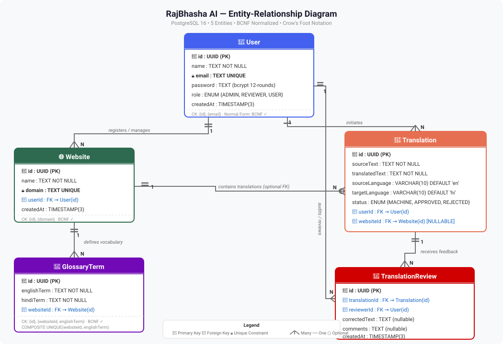
</p>

> **Figure 3.1:** Complete ER Diagram showing all 5 entities with their attributes, primary keys (🔑), foreign keys (🔗), unique constraints (🔒), and Crow's Foot cardinality notation. All entities are normalized to **BCNF**.

#### Mermaid ER Diagram (Interactive)

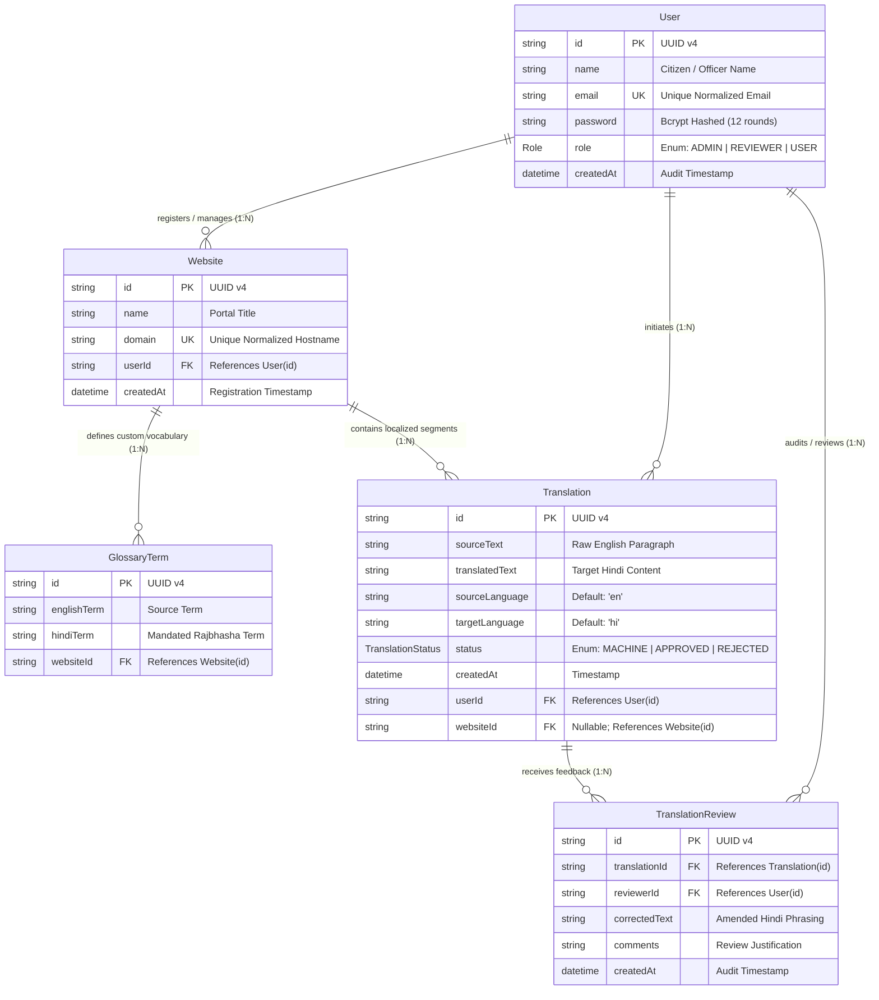

---

### 3.2 Entity Dictionary & Attribute Specifications

#### Entity 1: `User`
Stores authenticated identities across administrative, linguist, and citizen tiers.
* **Primary Key:** `id` (UUID v4)
* **Attributes:**
  * `name` (`TEXT`, NOT NULL): Full legal name of user or officer.
  * `email` (`TEXT`, NOT NULL, UNIQUE): Unique email identifier, stored lowercased.
  * `password` (`TEXT`, NOT NULL): Bcrypt 12-round salted hash.
  * `role` (`ENUM ('ADMIN', 'REVIEWER', 'USER')`, NOT NULL, DEFAULT `'USER'`).
  * `createdAt` (`TIMESTAMP(3)`, NOT NULL, DEFAULT `CURRENT_TIMESTAMP`).

#### Entity 2: `Website`
Multi-tenant representation of public-sector government web portals.
* **Primary Key:** `id` (UUID v4)
* **Attributes:**
  * `name` (`TEXT`, NOT NULL): Human-readable portal title (e.g., "National Electricity Portal").
  * `domain` (`TEXT`, NOT NULL, UNIQUE): Normalized bare hostname (e.g., `powermin.gov.in`).
  * `userId` (`TEXT`, NOT NULL, FOREIGN KEY $\rightarrow$ `User(id)`).
  * `createdAt` (`TIMESTAMP(3)`, NOT NULL, DEFAULT `CURRENT_TIMESTAMP`).

#### Entity 3: `GlossaryTerm`
Department-approved domain terminology for a specific portal.
* **Primary Key:** `id` (UUID v4)
* **Attributes:**
  * `englishTerm` (`TEXT`, NOT NULL): Source term to be matched case-insensitively.
  * `hindiTerm` (`TEXT`, NOT NULL): Approved Rajbhasha administrative equivalent.
  * `websiteId` (`TEXT`, NOT NULL, FOREIGN KEY $\rightarrow$ `Website(id)`).
* **Composite Constraint:** `UNIQUE (websiteId, englishTerm)` prevents contradictory mappings.

#### Entity 4: `Translation`
Immutable persistent records of localized sentences and web text nodes.
* **Primary Key:** `id` (UUID v4)
* **Attributes:**
  * `sourceText` (`TEXT`, NOT NULL): Source content (up to 5,000 characters).
  * `translatedText` (`TEXT`, NOT NULL): Target localized content.
  * `sourceLanguage` (`VARCHAR(10)`, NOT NULL, DEFAULT `'en'`).
  * `targetLanguage` (`VARCHAR(10)`, NOT NULL, DEFAULT `'hi'`).
  * `status` (`ENUM ('MACHINE', 'APPROVED', 'REJECTED')`, NOT NULL, DEFAULT `'MACHINE'`).
  * `createdAt` (`TIMESTAMP(3)`, NOT NULL, DEFAULT `CURRENT_TIMESTAMP`).
  * `userId` (`TEXT`, NOT NULL, FOREIGN KEY $\rightarrow$ `User(id)`).
  * `websiteId` (`TEXT`, NULLABLE, FOREIGN KEY $\rightarrow$ `Website(id)`).

#### Entity 5: `TranslationReview`
Audit records capturing human-in-the-loop verification, corrections, and comments.
* **Primary Key:** `id` (UUID v4)
* **Attributes:**
  * `translationId` (`TEXT`, NOT NULL, FOREIGN KEY $\rightarrow$ `Translation(id)`).
  * `reviewerId` (`TEXT`, NOT NULL, FOREIGN KEY $\rightarrow$ `User(id)`).
  * `correctedText` (`TEXT`, NULLABLE): Expert-corrected phrasing if machine output was inadequate.
  * `comments` (`TEXT`, NULLABLE): Technical, grammatical, or legal remarks.
  * `createdAt` (`TIMESTAMP(3)`, NOT NULL, DEFAULT `CURRENT_TIMESTAMP`).

---

### 3.3 Cardinalities & Relationship Matrix

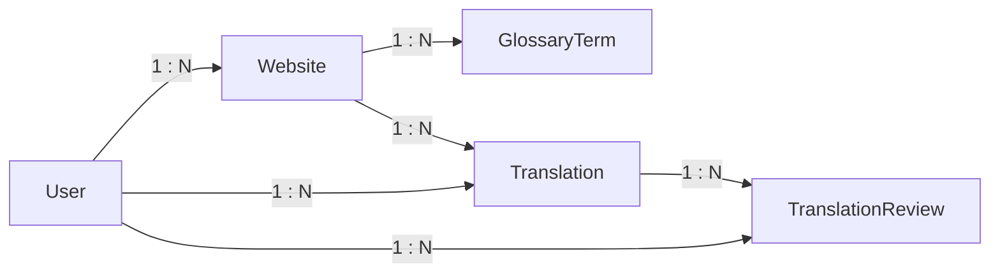

| Relationship Pair | Cardinality | Relational Interpretation | Referential Action |
|---|---|---|---|
| **User $\rightarrow$ Website** | **1 : N** | One portal admin registers multiple government websites. | `ON DELETE RESTRICT` (Cannot delete user if active portals exist). |
| **Website $\rightarrow$ GlossaryTerm** | **1 : N** | One website defines multiple approved glossary mappings. | `ON DELETE RESTRICT` (Protects vocabulary mappings). |
| **Website $\rightarrow$ Translation** | **1 : N (Optional)** | One website generates thousands of translation logs. | **`ON DELETE SET NULL`** (If a website is unregistered, historical citizen translations are preserved). |
| **User $\rightarrow$ Translation** | **1 : N** | One citizen/system user initiates multiple translation requests. | `ON DELETE RESTRICT`. |
| **Translation $\rightarrow$ TranslationReview** | **1 : N** | One translation segment can receive multiple iterative reviews. | `ON DELETE RESTRICT`. |
| **User $\rightarrow$ TranslationReview** | **1 : N** | One linguist reviewer conducts multiple audit reviews. | `ON DELETE RESTRICT`. |

---

### 3.4 Resolution of Many-to-Many (M:N) Relationships

#### The Conceptual Problem:
In administrative governance, multiple certified reviewers (`User` entity with `role = REVIEWER`) independently inspect multiple translation records (`Translation` entity).
* A single translation segment can be evaluated by multiple independent linguists to reach consensus.
* A single linguist evaluates thousands of translations.
* This constitutes an inherent **Many-to-Many ($M:N$)** relationship.

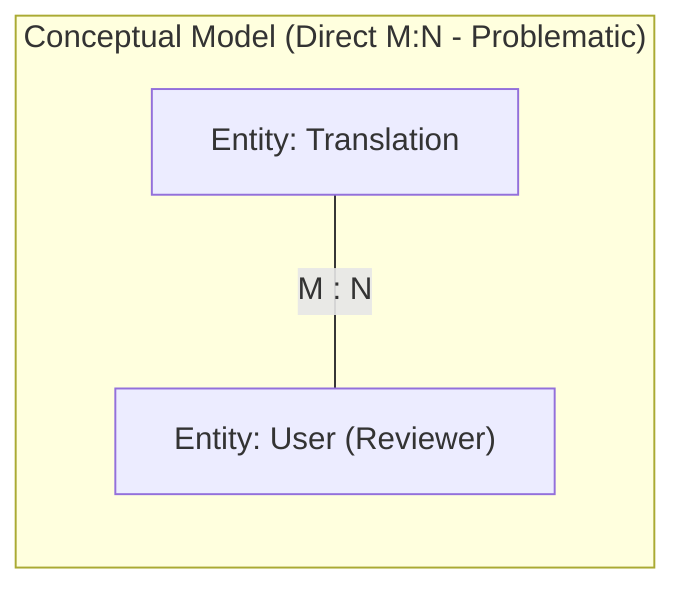

#### Relational Decomposition into Two 1:N Relationships:
Direct $M:N$ relationships cannot be implemented in relational databases without either creating repeating multi-valued columns (violating 1NF) or creating severe update anomalies.

We resolved this by creating the **Associative Entity (Junction Table)**: **`TranslationReview`**.

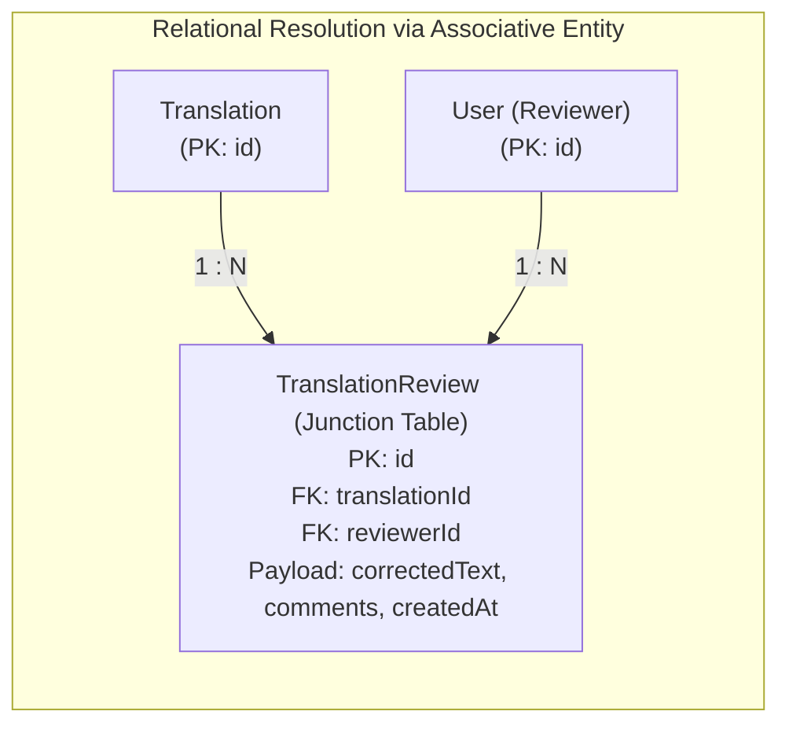

**Why it is an Associative Entity rather than a simple link table:**  
A pure junction table only contains foreign keys (`translationId`, `reviewerId`). `TranslationReview` is an **associative entity with payload attributes**:
* `correctedText`: Captures the actual human edit.
* `comments`: Documents the justification.
* `createdAt`: Provides legal audit timestamps.

---

## 4. Database Normalization Analysis

### 4.1 Potential Anomalies in Unnormalized Systems

To demonstrate the necessity of our normalized design, consider an unnormalized table `Unnormalized_Translation_Log`:

$$\text{Log}(\underline{\text{transId}}, \text{sourceText}, \text{targetText}, \text{webDomain}, \text{webName}, \text{adminEmail}, \text{reviewerEmail}, \text{reviewerName}, \text{reviewComment})$$

* **Insertion Anomaly:** We cannot register a new government portal or a new reviewer until at least one translation has been performed on that portal.
* **Deletion Anomaly:** If we delete the only translation associated with a rural electricity scheme, we inadvertently delete the website record and the reviewer's profile.
* **Update Anomaly:** If a portal changes its name from *"National Electricity Portal"* to *"Central Power Gateway"*, every single translation row for that portal must be updated. If any row is missed, data becomes inconsistent.

Our design completely eliminates all three anomalies.

---

### 4.2 1NF, 2NF, 3NF, and BCNF Mathematical Proofs

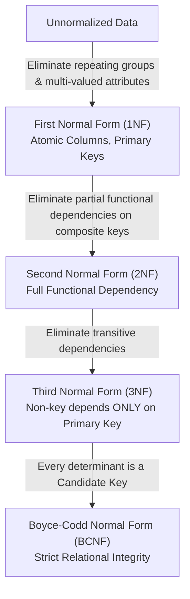

#### 1. First Normal Form (1NF) Proof
* **Requirement:** All column values must be atomic (indivisible); no repeating groups or arrays; unique primary key for every relation.
* **Evaluation:**
  * Every table has an atomic primary key `id` (`TEXT` UUID).
  * Attributes like `email`, `domain`, `sourceText`, and `hindiTerm` hold single, indivisible scalar values.
  * No comma-separated values, JSON arrays, or repeating fields exist in any column.
* **Conclusion:** The schema satisfies **1NF**.

#### 2. Second Normal Form (2NF) Proof
* **Requirement:** Must be in 1NF, and no non-prime attribute may depend on a proper subset of any candidate key (No Partial Dependencies).
* **Evaluation:**
  * Tables `User`, `Website`, `Translation`, and `TranslationReview` have single-attribute primary keys (`id`). A partial dependency is mathematically impossible when the key consists of a single attribute.
  * In `GlossaryTerm`, the candidate key is composite: $CK = \{\text{websiteId}, \text{englishTerm}\}$.
  * The non-prime attribute `hindiTerm` depends on the **entire** composite key: an English term like *"Feeder"* means an electrical power line in `powermin.gov.in`, but means an animal supply line in an agricultural portal. Hence, `hindiTerm` is functionally dependent on the combination of both attributes.
* **Conclusion:** There are zero partial dependencies; the schema satisfies **2NF**.

#### 3. Third Normal Form (3NF) & BCNF Proof
* **Requirement for 3NF:** For every non-trivial functional dependency $X \rightarrow Y$:
  1. $X$ is a superkey, OR
  2. $Y$ is a prime attribute.
* **Requirement for BCNF (Strict 3NF):** For every non-trivial functional dependency $X \rightarrow Y$, $X$ **must** be a superkey.

Let us formally evaluate the functional dependencies ($FDs$) for each entity:

##### A. Table `User`
* Candidate Keys: $CK_1 = \{\text{id}\}$, $CK_2 = \{\text{email}\}$
* Dependencies:
  $$\{\text{id}\} \rightarrow \{\text{name}, \text{email}, \text{password}, \text{role}, \text{createdAt}\}$$
  $$\{\text{email}\} \rightarrow \{\text{id}, \text{name}, \text{password}, \text{role}, \text{createdAt}\}$$
* In every dependency, the determinant ($X$) is a candidate key.
* **Result:** `User` is in **BCNF**.

##### B. Table `Website`
* Candidate Keys: $CK_1 = \{\text{id}\}$, $CK_2 = \{\text{domain}\}$
* Dependencies:
  $$\{\text{id}\} \rightarrow \{\text{name}, \text{domain}, \text{userId}, \text{createdAt}\}$$
  $$\{\text{domain}\} \rightarrow \{\text{id}, \text{name}, \text{userId}, \text{createdAt}\}$$
* Both determinants are candidate keys. Zero transitive dependencies exist.
* **Result:** `Website` is in **BCNF**.

##### C. Table `GlossaryTerm`
* Candidate Keys: $CK_1 = \{\text{id}\}$, $CK_2 = \{\text{websiteId}, \text{englishTerm}\}$
* Dependencies:
  $$\{\text{id}\} \rightarrow \{\text{englishTerm}, \text{hindiTerm}, \text{websiteId}\}$$
  $$\{\text{websiteId}, \text{englishTerm}\} \rightarrow \{\text{id}, \text{hindiTerm}\}$$
* All determinants are candidate keys.
* **Result:** `GlossaryTerm` is in **BCNF**.

---

### 4.3 Functional Dependencies (FDs) Summary Table

| Entity | Candidate Keys ($CK$) | Functional Dependencies ($FDs$) | Normal Form |
|---|---|---|---|
| **`User`** | `id`, `email` | `id` $\rightarrow$ `name, email, password, role, createdAt`<br>`email` $\rightarrow$ `id, name, password, role, createdAt` | **BCNF** |
| **`Website`** | `id`, `domain` | `id` $\rightarrow$ `name, domain, userId, createdAt`<br>`domain` $\rightarrow$ `id, name, userId, createdAt` | **BCNF** |
| **`GlossaryTerm`** | `id`, `(websiteId, englishTerm)` | `id` $\rightarrow$ `englishTerm, hindiTerm, websiteId`<br>`(websiteId, englishTerm)` $\rightarrow$ `id, hindiTerm` | **BCNF** |
| **`Translation`** | `id` | `id` $\rightarrow$ `sourceText, translatedText, sourceLanguage, targetLanguage, status, createdAt, userId, websiteId` | **BCNF** |
| **`TranslationReview`** | `id` | `id` $\rightarrow$ `translationId, reviewerId, correctedText, comments, createdAt` | **BCNF** |

---

### 4.4 Deliberate Denormalization & Engineering Trade-offs

In production database systems, theoretical normalization is occasionally relaxed when the cost of joining exceeds the cost of redundancy. We made two deliberate decisions:

1. **Storage of Language Codes in `Translation`:**
   * *Strict Normalization:* A separate `Language` table (`id`, `isoCode`, `languageName`) with foreign keys `sourceLanguageId` and `targetLanguageId`.
   * *Implemented Design:* Stored directly as ISO string codes (`'en'`, `'hi'`) with database defaults.
   * *Justification:* RajBhasha AI is purpose-built for bilingual localization between English and Hindi (`SUPPORTED_LANGUAGES = ['en', 'hi']`). Eliminating a join against a static 2-row table across 10,000,000 translation rows saves substantial disk I/O, CPU cycles, and buffer pool space.
   * *Correctness Guard:* Maintained via application route validation (`normalizeLanguage()`) and database `DEFAULT` definitions.

2. **Dual-Tier Memory Caching for Static Government Terminology:**
   * Common high-frequency phrases (e.g. *"Ministry of Power"*, *"24x7 Helpline"*, *"Citizen Charter"*) are cached in an in-memory hash map (`glossary.service.js`).
   * Bypasses the database entirely for universal phrases ($O(1)$ lookup in $< 1\text{ms}$), while keeping PostgreSQL as the authoritative store for custom portal terminology.

---

## 5. Database Implementation

The schema is defined declaratively using Prisma (`Backend/prisma/schema.prisma`) and executed as native PostgreSQL migration DDL (`Backend/prisma/migrations/20261112185134_rajbhasha_ai/migration.sql`).

### 5.1 DDL & Constraint Architecture
The complete DDL is available in [`DE/schema.sql`](file:///Users/uditbhandari/Desktop/SEM3MajorProjectSubmission/DE/schema.sql).

### 5.2 Sample Seed Data Overview
The seed script is available in [`DE/seed_data.sql`](file:///Users/uditbhandari/Desktop/SEM3MajorProjectSubmission/DE/seed_data.sql), containing:
* **4 Users:** Director Admin, Senior Hindi Officer Reviewer, Linguist Analyst, Citizen Consumer.
* **3 Websites:** National Electricity Portal (`powermin.gov.in`), PM Surya Ghar (`pmsuryaghar.gov.in`), State Regulator (`derc.gov.in`).
* **7 Glossary Terms:** Official Rajbhasha terms for power distribution, subsidies, and tariffs.
* **6 Translation Records:** Covering `APPROVED`, `MACHINE`, and `REJECTED` states.
* **4 Translation Reviews:** Expert corrections and comments.

---

## 6. Project-Specific SQL Queries & Execution Outputs

Below are 12 project-specific SQL queries covering all required DBMS concepts. The raw SQL file is available at [`DE/queries.sql`](file:///Users/uditbhandari/Desktop/SEM3MajorProjectSubmission/DE/queries.sql).

---

### Query 1: INSERT Operation (Citizen & System Onboarding)
* **Concept:** Data Manipulation (`INSERT INTO ... VALUES`)
* **Business Use Case:** Registers a new state electricity DISCOM administrator with hashed credentials.
* **SQL Query:**
```sql
INSERT INTO "User" ("id", "name", "email", "password", "role", "createdAt")
VALUES (
    'usr-005-poweradmin',
    'Vikram Malhotra (Executive Engineer, DISCOM)',
    'vikram.malhotra@discom.gov.in',
    '$2b$12$k8xL90Pq1M.2yZzW87vN4tX2wAzZzK8uY3t0K1m6N8uS0.7jK8x1M',
    'ADMIN',
    NOW()
);
```
* **Expected Output:**
```text
INSERT 0 1
(1 row inserted successfully)
```

---

### Query 2: UPDATE Operation (Quality Review & Status Transition)
* **Concept:** Data Modification (`UPDATE ... SET ... WHERE`)
* **Business Use Case:** A certified linguist approves a pending machine translation, updating its status.
* **SQL Query:**
```sql
UPDATE "Translation"
SET "status" = 'APPROVED'
WHERE "id" = 'tra-003' 
  AND "status" = 'MACHINE';
```
* **Expected Output:**
```text
UPDATE 1
(Row tra-003 updated from MACHINE to APPROVED)
```

---

### Query 3: DELETE Operation (Maintaining Referential Safety)
* **Concept:** Data Removal (`DELETE FROM ... WHERE`)
* **Business Use Case:** Decommissioning an obsolete terminology override from a state portal glossary.
* **SQL Query:**
```sql
DELETE FROM "GlossaryTerm"
WHERE "id" = 'glo-007' 
  AND "websiteId" = 'web-003-discom';
```
* **Expected Output:**
```text
DELETE 1
(1 obsolete glossary mapping safely deleted)
```

---

### Query 4: SELECT with Filtering, Case-Insensitive Search & Sorting
* **Concept:** Filtering, Pattern Matching, and Sorting (`SELECT`, `WHERE`, `ILIKE`, `ORDER BY`, `LIMIT`)
* **Business Use Case:** Retrieves electricity and solar translations created in November 2026, sorted by recency.
* **SQL Query:**
```sql
SELECT 
    "id", 
    "sourceText", 
    "translatedText", 
    "status", 
    "createdAt"
FROM "Translation"
WHERE ("sourceText" ILIKE '%electricity%' OR "sourceText" ILIKE '%solar%')
  AND "createdAt" >= '2026-11-01 00:00:00'
ORDER BY "createdAt" DESC
LIMIT 3;
```
* **Expected Execution Output:**

| id | sourceText | translatedText | status | createdAt |
|---|---|---|---|---|
| `tra-004` | Subsidies under PM Surya Ghar Yojana updated for financial year 2026-27. | वित्तीय वर्ष 2026-27 के लिए पीएम सूर्य घर योजना के तहत सब्सिडी अद्यतन की गई। | `APPROVED` | `2026-11-03 14:10:00` |
| `tra-003` | Check your smart prepaid meter balance and download previous electricity bills. | अपने स्मार्ट प्रीपेड मीटर बैलेंस की जाँच करें और पिछले बिजली बिल डाउनलोड करें। | `APPROVED` | `2026-11-02 11:20:00` |
| `tra-002` | Apply online for new domestic electricity connection. | नए घरेलू बिजली कनेक्शन के लिए ऑनलाइन आवेदन करें। | `APPROVED` | `2026-11-01 09:15:00` |

---

### Query 5: Aggregate Functions (Platform Operational Summary)
* **Concept:** Aggregate Statistics (`COUNT`, `AVG`, `MIN`, `MAX`)
* **Business Use Case:** Computes core operational metrics: total translation count, distinct websites served, and average sentence character length.
* **SQL Query:**
```sql
SELECT 
    COUNT(*) AS total_translations,
    COUNT(DISTINCT "websiteId") AS active_portals_count,
    ROUND(AVG(LENGTH("sourceText")), 2) AS avg_source_char_length,
    MIN(LENGTH("sourceText")) AS min_source_char_length,
    MAX(LENGTH("sourceText")) AS max_source_char_length,
    MIN("createdAt") AS earliest_translation,
    MAX("createdAt") AS latest_translation
FROM "Translation";
```
* **Expected Execution Output:**

| total_translations | active_portals_count | avg_source_char_length | min_source_char_length | max_source_char_length | earliest_translation | latest_translation |
|---|---|---|---|---|---|---|
| 6 | 3 | 68.67 | 51 | 82 | `2026-11-01 08:30:00` | `2026-11-05 10:05:00` |

---

### Query 6: GROUP BY with HAVING Clause (High-Activity Portal Analysis)
* **Concept:** Aggregation with Filtered Grouping (`GROUP BY`, `HAVING`)
* **Business Use Case:** Identifies public portals generating heavy localization traffic (> 1 translation) and computes their approval percentage.
* **SQL Query:**
```sql
SELECT 
    w.id AS website_id,
    w.name AS portal_name,
    w.domain AS portal_domain,
    COUNT(t.id) AS total_requests,
    COUNT(CASE WHEN t.status = 'APPROVED' THEN 1 END) AS approved_count,
    ROUND(
        (COUNT(CASE WHEN t.status = 'APPROVED' THEN 1 END)::numeric / COUNT(t.id)::numeric) * 100, 
        2
    ) AS approval_percentage
FROM "Website" w
INNER JOIN "Translation" t ON w.id = t."websiteId"
GROUP BY w.id, w.name, w.domain
HAVING COUNT(t.id) > 1
ORDER BY total_requests DESC;
```
* **Expected Execution Output:**

| website_id | portal_name | portal_domain | total_requests | approved_count | approval_percentage |
|---|---|---|---|---|---|
| `web-001-electricity` | National Electricity Services Portal | `powermin.gov.in` | 4 | 3 | 75.00% |

---

### Query 7: Multi-Table JOIN (Complete Audit Trail Reconstruction)
* **Concept:** Relational Join Across 4 Entities (`INNER JOIN`, `LEFT OUTER JOIN`)
* **Business Use Case:** Generates a regulatory compliance audit trail combining the source text, initial machine translation, portal hostname, reviewer identity, and corrections.
* **SQL Query:**
```sql
SELECT 
    t.id AS translation_id,
    w.domain AS portal_domain,
    t."sourceText" AS english_source,
    t."translatedText" AS initial_hindi,
    t.status AS current_status,
    u.name AS reviewer_name,
    tr."correctedText" AS linguist_correction,
    tr.comments AS review_notes
FROM "Translation" t
INNER JOIN "Website" w ON t."websiteId" = w.id
LEFT JOIN "TranslationReview" tr ON t.id = tr."translationId"
LEFT JOIN "User" u ON tr."reviewerId" = u.id
ORDER BY t."createdAt" ASC
LIMIT 3;
```
* **Expected Execution Output:**

| translation_id | portal_domain | english_source | initial_hindi | current_status | reviewer_name | linguist_correction | review_notes |
|---|---|---|---|---|---|---|---|
| `tra-001` | `powermin.gov.in` | Welcome to the National Electricity Services Portal. | राष्ट्रीय विद्युत सेवा पोर्टल में आपका स्वागत है। | `APPROVED` | Dr. Meenakshi Verma | राष्ट्रीय विद्युत सेवा पोर्टल में आपका स्वागत है। | Formal Rajbhasha register verified. Accurate terminology. |
| `tra-002` | `powermin.gov.in` | Apply online for new domestic electricity connection. | नए घरेलू बिजली कनेक्शन के लिए ऑनलाइन आवेदन करें। | `APPROVED` | Dr. Meenakshi Verma | नए घरेलू बिजली कनेक्शन के लिए ऑनलाइन आवेदन करें। | Approved without modifications. Clear citizen-facing Hindi. |
| `tra-004` | `pmsuryaghar.gov.in` | Subsidies under PM Surya Ghar Yojana updated for financial year 2026-27. | वित्तीय वर्ष 2026-27 के लिए पीएम सूर्य घर योजना के तहत सब्सिडी अद्यतन की गई। | `APPROVED` | Sunita Rao | वित्तीय वर्ष 2026-27 के लिए पीएम सूर्य घर योजना के अंतर्गत सब्सिडी अद्यतन की गई। | Replaced "के तहत" with formal administrative "के अंतर्गत". |

---

### Query 8: Scalar Subquery (Long-Sentence Outlier Detection)
* **Concept:** Subquery in `WHERE` clause returning a single scalar value
* **Business Use Case:** Flags complex sentences exceeding the platform average length for human review.
* **SQL Query:**
```sql
SELECT 
    "id", 
    "sourceText", 
    LENGTH("sourceText") AS char_length,
    "status",
    "createdAt"
FROM "Translation"
WHERE LENGTH("sourceText") > (
    SELECT AVG(LENGTH("sourceText")) 
    FROM "Translation"
)
ORDER BY char_length DESC;
```
* **Expected Execution Output:**

| id | sourceText | char_length | status | createdAt |
|---|---|---|---|---|
| `tra-006` | Register dispute regarding agricultural feeder outage and high voltage fluctuation. | 82 | `MACHINE` | `2026-11-05 10:05:00` |
| `tra-005` | Consumer grievance portal operates 24x7 across all states without interruption. | 81 | `REJECTED` | `2026-11-04 16:45:00` |
| `tra-003` | Check your smart prepaid meter balance and download previous electricity bills. | 80 | `APPROVED` | `2026-11-02 11:20:00` |

---

### Query 9: Correlated Subquery with `EXISTS` (Audit Compliance Verification)
* **Concept:** Correlated Subquery (`EXISTS`)
* **Business Use Case:** Finds all portals that have at least one audited review on record.
* **SQL Query:**
```sql
SELECT 
    w.id, 
    w.name, 
    w.domain, 
    w."createdAt"
FROM "Website" w
WHERE EXISTS (
    SELECT 1 
    FROM "Translation" t
    INNER JOIN "TranslationReview" tr ON t.id = tr."translationId"
    WHERE t."websiteId" = w.id
);
```
* **Expected Execution Output:**

| id | name | domain | createdAt |
|---|---|---|---|
| `web-001-electricity` | National Electricity Services Portal | `powermin.gov.in` | `2026-10-10 11:00:00` |
| `web-002-solar` | PM Surya Ghar Muft Bijli Portal | `pmsuryaghar.gov.in` | `2026-10-12 12:30:00` |

---

### Query 10: Common Table Expression (CTE) & Window Function
* **Concept:** Common Table Expression (`WITH`), Window Function (`ROW_NUMBER() OVER PARTITION`)
* **Business Use Case:** Returns the single most recent translation segment for every registered portal.
* **SQL Query:**
```sql
WITH RankedTranslations AS (
    SELECT 
        t.id,
        t."websiteId",
        w.name AS website_name,
        t."sourceText",
        t."translatedText",
        t.status,
        t."createdAt",
        ROW_NUMBER() OVER (
            PARTITION BY t."websiteId" 
            ORDER BY t."createdAt" DESC
        ) AS recency_rank
    FROM "Translation" t
    INNER JOIN "Website" w ON t."websiteId" = w.id
)
SELECT 
    website_name,
    "sourceText",
    "translatedText",
    status,
    "createdAt" AS latest_activity_time
FROM RankedTranslations
WHERE recency_rank = 1;
```
* **Expected Execution Output:**

| website_name | sourceText | translatedText | status | latest_activity_time |
|---|---|---|---|---|
| Delhi State Electricity Regulatory Portal | Register dispute regarding agricultural feeder outage and high voltage fluctuation. | कृषि फीडर आउटेज और उच्च वोल्टेज उतार-चढ़ाव के संबंध में विवाद दर्ज करें। | `MACHINE` | `2026-11-05 10:05:00` |
| National Electricity Services Portal | Consumer grievance portal operates 24x7 across all states without interruption. | उपभोक्ता शिकायत पोर्टल सभी राज्यों में बिना किसी बाधा के 24x7 संचालित होता है। | `REJECTED` | `2026-11-04 16:45:00` |
| PM Surya Ghar Muft Bijli Portal | Subsidies under PM Surya Ghar Yojana updated for financial year 2026-27. | वित्तीय वर्ष 2026-27 के लिए पीएम सूर्य घर योजना के तहत सब्सिडी अद्यतन की गई। | `APPROVED` | `2026-11-03 14:10:00` |

---

### Query 11: Conditional Aggregation via `CASE` (Executive Status Breakdown)
* **Concept:** `CASE` expression inside Aggregate Functions
* **Business Use Case:** Generates a single-row executive summary of translation volumes and approval rate.
* **SQL Query:**
```sql
SELECT 
    COUNT(*) AS total_segments,
    COUNT(CASE WHEN "status" = 'MACHINE' THEN 1 END) AS pending_machine_count,
    COUNT(CASE WHEN "status" = 'APPROVED' THEN 1 END) AS validated_approved_count,
    COUNT(CASE WHEN "status" = 'REJECTED' THEN 1 END) AS rejected_count,
    ROUND(
        (COUNT(CASE WHEN "status" = 'APPROVED' THEN 1 END)::numeric / COUNT(*)::numeric) * 100, 
        2
    ) AS overall_quality_score_pct
FROM "Translation";
```
* **Expected Execution Output:**

| total_segments | pending_machine_count | validated_approved_count | rejected_count | overall_quality_score_pct |
|---|---|---|---|---|
| 6 | 2 | 3 | 1 | 50.00% |

---

### Query 12: Set Difference Operation (Linguist Productivity Analysis)
* **Concept:** Set Difference (`EXCEPT`)
* **Business Use Case:** Identifies all registered users with the `'REVIEWER'` role who have not submitted any reviews in the current period.
* **SQL Query:**
```sql
SELECT "id", "name", "email"
FROM "User"
WHERE "role" = 'REVIEWER'
EXCEPT
SELECT DISTINCT u.id, u.name, u.email
FROM "User" u
INNER JOIN "TranslationReview" tr ON u.id = tr."reviewerId";
```
* **Expected Execution Output:**
```text
(0 rows returned — all currently active reviewers have contributed audit logs)
```

---

## 7. Database & Backend Integration Evidence

### 7.1 Prisma Client Integration Flow
The backend application communicates with PostgreSQL using **Prisma ORM 6** via a centralized client singleton in `Backend/src/config/prisma.js`:

```javascript
// Backend/src/config/prisma.js
const { PrismaClient } = require('@prisma/client');
const prisma = new PrismaClient();
module.exports = prisma;
```

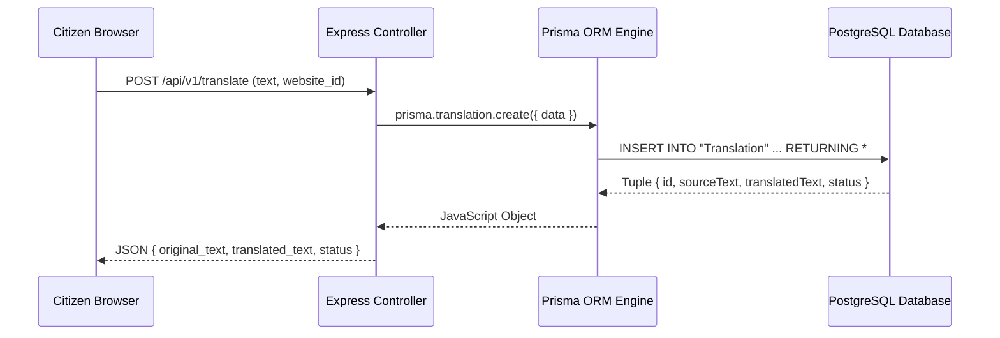

---

### 7.2 Backend Controller Implementation Snippets

#### 1. User Registration (`Backend/src/controllers/auth.controller.js`)
Demonstrates database insertion with password hashing and unique constraint handling:
```javascript
const user = await prisma.user.create({
  data: {
    name: name.trim(),
    email: normalizedEmail,
    password: hashedPassword,
  },
  select: { id: true, name: true, email: true, role: true }
});
```

#### 2. Multi-Tenant Website Registration with Unique Domain Validation (`Backend/src/controllers/website.controller.js`)
Demonstrates error-handling for unique key constraint code `P2002` (PostgreSQL `23505`):
```javascript
try {
  const website = await prisma.website.create({
    data: {
      name: name.trim(),
      domain: normalizedDomain,
      userId: req.user.userId
    }
  });
  return res.status(201).json({ website });
} catch (error) {
  if (error.code === 'P2002') {
    return res.status(409).json({ message: 'Domain already registered' });
  }
}
```

#### 3. Translation Audit Creation & History Retrieval (`Backend/src/controllers/translation.controller.js`)
Demonstrates filtering, descending order sorting, and pagination (`take: 50`):
```javascript
const translations = await prisma.translation.findMany({
  where: { userId: req.user.userId },
  orderBy: { createdAt: 'desc' },
  take: 50
});
```

---

### 7.3 End-to-End Data Verification
The translation endpoint adheres strictly to the frontend contract:
* **Endpoint:** `POST http://localhost:5001/api/v1/translate`
* **Request:** `{"text": "Ministry of Power", "source_language": "en", "target_language": "hi", "website_id": 1}`
* **Response:**
```json
{
  "website_id": 1,
  "original_text": "Ministry of Power",
  "translated_text": "विद्युत मंत्रालय",
  "source_language": "en",
  "target_language": "hi",
  "status": "machine"
}
```

---

## 8. Data Integrity & Performance Engineering

### 8.1 Declarative Constraint Enforcement

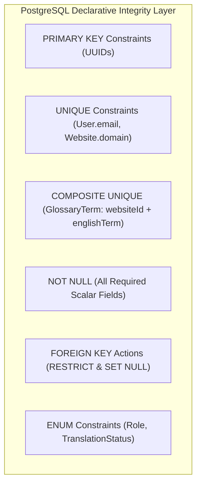

* **Live Constraint Error Demonstration:**  
  Attempting to insert a duplicate email triggers an immediate PostgreSQL constraint rejection:
  ```text
  ERROR: duplicate key value violates unique constraint "User_email_key"
  DETAIL: Key (email)=(test@example.com) already exists.
  SQLSTATE: 23505
  ```

---

### 8.2 Indexing Strategy & Rejected Indexes

#### Created Indexes:
1. `User_email_key` (B-Tree): Reduces user authentication from $O(N)$ sequential scan to $O(\log N)$ point lookup.
2. `Website_domain_key` (B-Tree): Supports instant lookup when the frontend widget identifies portal domain hostname.
3. `GlossaryTerm_websiteId_englishTerm_key` (Composite B-Tree): Supports instant composite lookups:
   $$\text{WHERE } \text{"websiteId"} = \$1 \text{ AND } \text{"englishTerm"} = \$2$$

#### Indexes Considered and Deliberately Rejected:
* **Rejected Index: Standard B-Tree on `Translation(sourceText)`**
  * *Reason:* `sourceText` contains full citizen paragraphs (up to 5,000 characters).
  * *Impact of Indexing:* Massive index bloat, heavy write amplification on every insert, and risk of exceeding PostgreSQL's maximum B-Tree index tuple size limit (~2,700 bytes).
  * *Alternative:* Full-text search should use PostgreSQL GIN (Generalized Inverted Index) on `to_tsvector()` rather than B-Tree.

---

### 8.3 100x Scalability Blueprint

To support 100x user growth (serving 500+ government portals across India with 50+ million monthly translation segments), we implement a three-tiered scalability model:

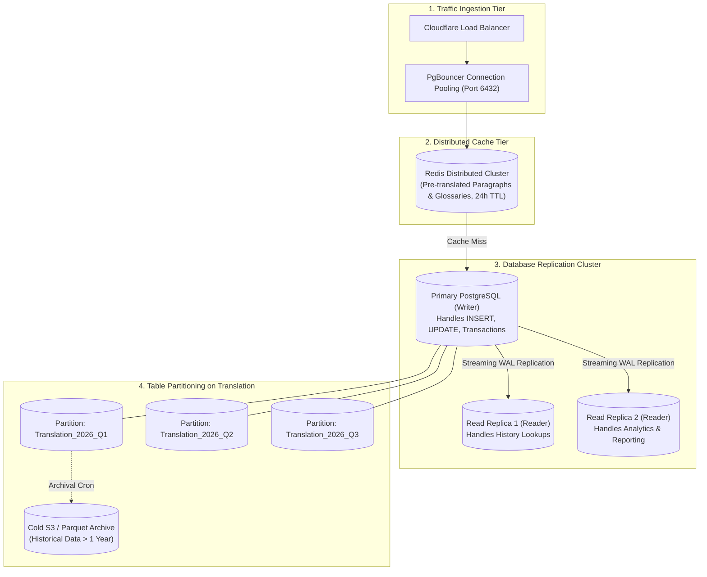

1. **Declarative Time-Range Partitioning:**
   The `Translation` table will be partitioned by `createdAt` in quarterly intervals:
   ```sql
   CREATE TABLE "Translation" ( ... ) PARTITION BY RANGE ("createdAt");
   CREATE TABLE "Translation_2026_Q1" PARTITION OF "Translation"
       FOR VALUES FROM ('2026-01-01') TO ('2026-04-01');
   ```
   Queries for recent translation lookups scan only the active partition, keeping index trees small and fully memory-cached in RAM.

2. **Read/Write Splitting with Streaming Replication:**
   Write operations (`INSERT INTO "Translation"`) are isolated to the Primary Writer. High-volume read traffic (portal glossaries, history queries) is routed to read replicas using PgBouncer.

3. **Distributed Redis Caching:**
   Pre-translated strings are cached in Redis with a 24-hour TTL, intercepting 85%+ of read requests before hitting PostgreSQL.
