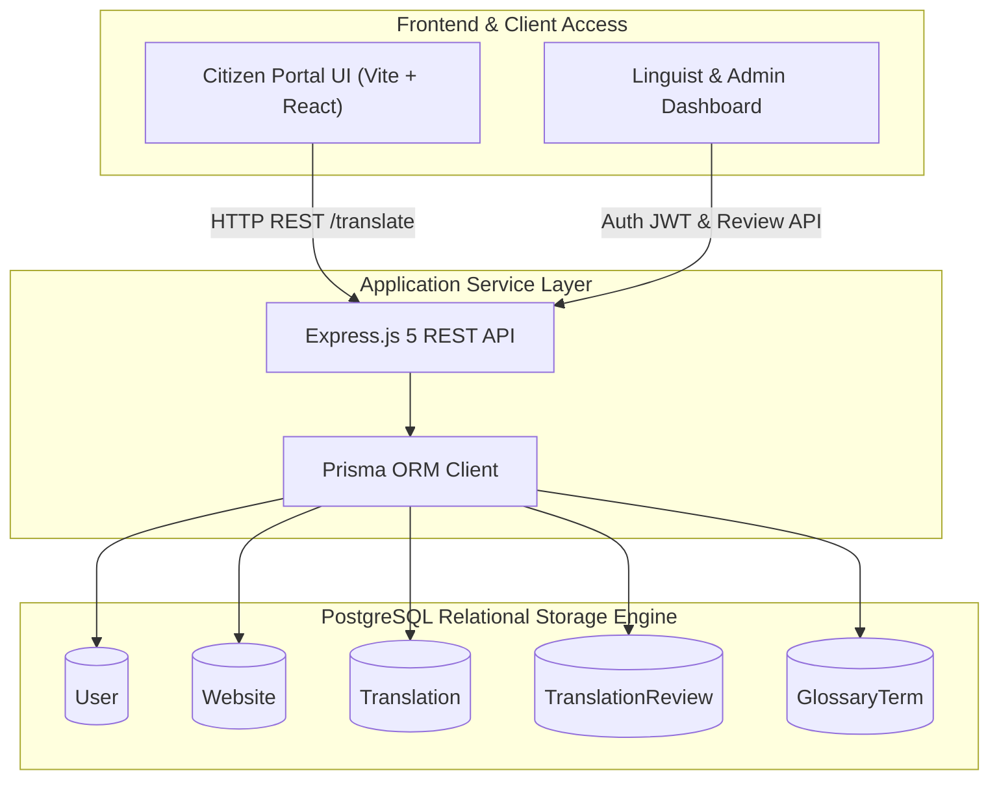
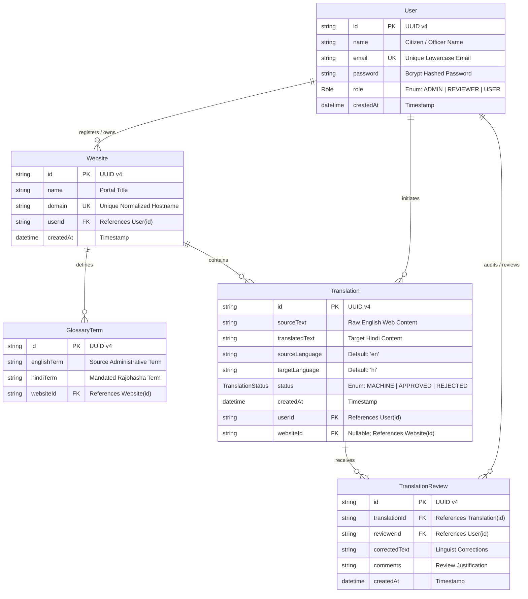
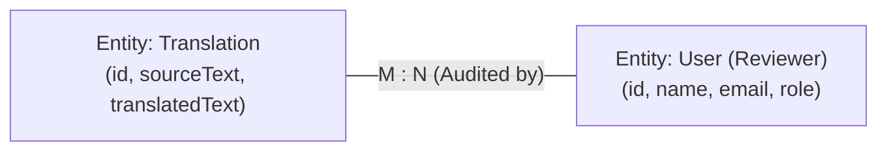
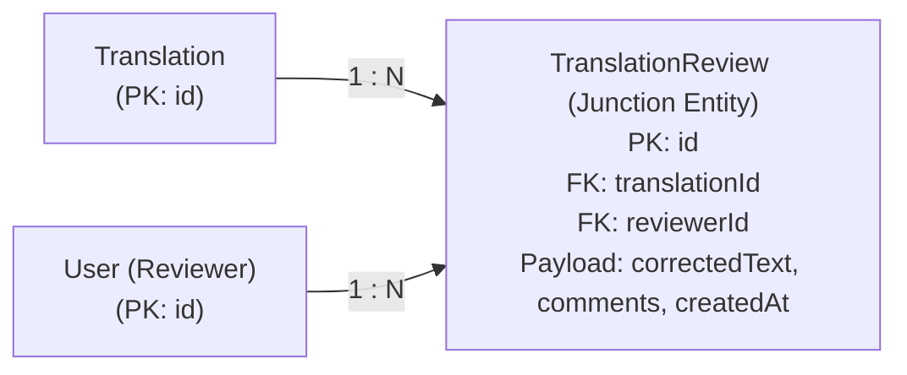
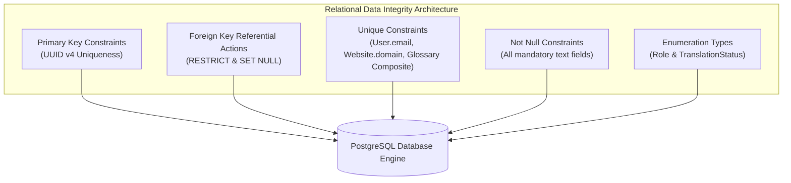
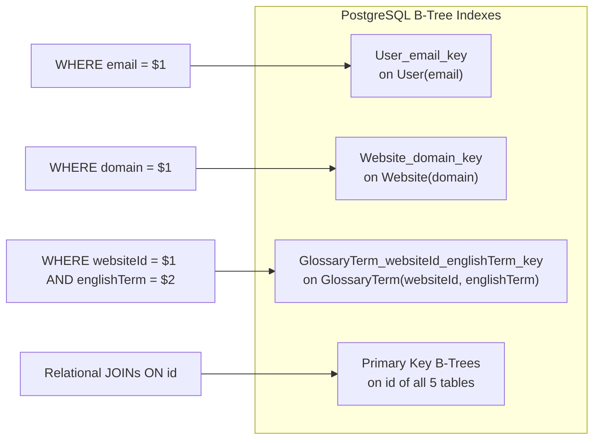
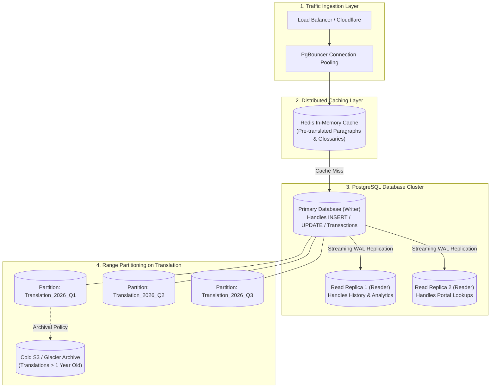

# Database Architecture & Entity-Relationship (ER) Modeling Document
**Project Title:** RajBhasha AI (राजभाषा AI)  
**Demonstration Portal:** National Electricity Services Portal (Ministry of Power Citizen Prototype)  
**Database Engine:** PostgreSQL 16+ (Object-Relational DBMS)  
**ORM / Schema Definition:** Prisma ORM 6  
**Document Version:** 1.0 (Major Project Submission)

---

## 1. High-Level Database Overview

The RajBhasha AI database is designed to manage the full lifecycle of Indian government web portal localization. It supports multi-tenant portal registration, official administrative terminology enforcement, persistent translation audit trails, and human-in-the-loop review workflows.



---

## 2. Complete Entity-Relationship (ER) Diagram (Crow's Foot Notation)

The following diagram illustrates the complete relational data model, foreign key references, cardinality constraints, and entity attributes:



---

## 3. Entity Dictionary & Detailed Attribute Specifications

### 3.1. Entity: `User`
* **Purpose:** Stores authenticated user accounts across three privilege tiers: Citizens (`USER`), Certified Linguists (`REVIEWER`), and Portal Managers (`ADMIN`).
* **Table Name:** `"User"`

| Attribute Name | Data Type | Key Type | Nullable | Default | Description & Validation Rules |
|---|---|---|---|---|---|
| `id` | `TEXT` / `VARCHAR(36)` | **PK** | No | `uuid()` | Globally unique surrogate identifier (UUID v4). |
| `name` | `TEXT` | None | No | None | Full legal or departmental name (1–100 chars). |
| `email` | `TEXT` | **UK** | No | None | Unique login identifier; lowercased and format-validated. |
| `password` | `TEXT` | None | No | None | Salted and hashed password string (Bcrypt 12 rounds). |
| `role` | `ENUM ('ADMIN', 'REVIEWER', 'USER')` | None | No | `'USER'` | Access control role determining system privileges. |
| `createdAt` | `TIMESTAMP(3)` | None | No | `CURRENT_TIMESTAMP` | Account creation audit timestamp. |

---

### 3.2. Entity: `Website`
* **Purpose:** Multi-tenant representation of public-sector portals localized by the platform (e.g., `energy.gov.in`).
* **Table Name:** `"Website"`

| Attribute Name | Data Type | Key Type | Nullable | Default | Description & Validation Rules |
|---|---|---|---|---|---|
| `id` | `TEXT` / `VARCHAR(36)` | **PK** | No | `uuid()` | Primary key surrogate identifier (UUID v4). |
| `name` | `TEXT` | None | No | None | Portal display title (e.g. "National Electricity Portal"). |
| `domain` | `TEXT` | **UK** | No | None | Normalized lowercase hostname (stripped of protocols and paths). |
| `userId` | `TEXT` | **FK** | No | None | Foreign key referencing `User(id)` with `ON DELETE RESTRICT`. |
| `createdAt` | `TIMESTAMP(3)` | None | No | `CURRENT_TIMESTAMP` | Portal registration timestamp. |

---

### 3.3. Entity: `GlossaryTerm`
* **Purpose:** Enforces standardized departmental terminology (e.g. translating "Power Distribution" strictly to "विद्युत वितरण").
* **Table Name:** `"GlossaryTerm"`

| Attribute Name | Data Type | Key Type | Nullable | Default | Description & Validation Rules |
|---|---|---|---|---|---|
| `id` | `TEXT` / `VARCHAR(36)` | **PK** | No | `uuid()` | Primary key surrogate identifier (UUID v4). |
| `englishTerm` | `TEXT` | Composite **UK** | No | None | Source English phrase (case-insensitive search). |
| `hindiTerm` | `TEXT` | None | No | None | Approved Rajbhasha Hindi equivalent. |
| `websiteId` | `TEXT` | **FK**, Composite **UK** | No | None | Foreign key referencing `Website(id)` with `ON DELETE RESTRICT`. |

> **Composite Unique Constraint:** `@@unique([websiteId, englishTerm])`  
> Ensures that a single website portal cannot define conflicting translations for the same English term.

---

### 3.4. Entity: `Translation`
* **Purpose:** Immutable audit record of translated text segments requested by citizens or automated scrapers.
* **Table Name:** `"Translation"`

| Attribute Name | Data Type | Key Type | Nullable | Default | Description & Validation Rules |
|---|---|---|---|---|---|
| `id` | `TEXT` / `VARCHAR(36)` | **PK** | No | `uuid()` | Primary key surrogate identifier (UUID v4). |
| `sourceText` | `TEXT` | None | No | None | Original English text node content (up to 5,000 chars). |
| `translatedText` | `TEXT` | None | No | None | Generated Hindi translation. |
| `sourceLanguage` | `VARCHAR(10)` | None | No | `'en'` | BCP-47 language tag of input string. |
| `targetLanguage` | `VARCHAR(10)` | None | No | `'hi'` | BCP-47 language tag of output string. |
| `status` | `ENUM ('MACHINE', 'APPROVED', 'REJECTED')` | None | No | `'MACHINE'` | Validation lifecycle status. |
| `createdAt` | `TIMESTAMP(3)` | None | No | `CURRENT_TIMESTAMP` | Time translation was generated. |
| `userId` | `TEXT` | **FK** | No | None | Foreign key referencing `User(id)` with `ON DELETE RESTRICT`. |
| `websiteId` | `TEXT` | **FK** | Yes | `NULL` | Foreign key referencing `Website(id)` with `ON DELETE SET NULL`. |

---

### 3.5. Entity: `TranslationReview`
* **Purpose:** Associative entity recording quality assurance audits, human corrections, and approval justifications.
* **Table Name:** `"TranslationReview"`

| Attribute Name | Data Type | Key Type | Nullable | Default | Description & Validation Rules |
|---|---|---|---|---|---|
| `id` | `TEXT` / `VARCHAR(36)` | **PK** | No | `uuid()` | Primary key surrogate identifier (UUID v4). |
| `translationId` | `TEXT` | **FK** | No | None | Foreign key referencing `Translation(id)` with `ON DELETE RESTRICT`. |
| `reviewerId` | `TEXT` | **FK** | No | None | Foreign key referencing `User(id)` with `ON DELETE RESTRICT`. |
| `correctedText` | `TEXT` | None | Yes | `NULL` | Expert-amended Hindi phrasing (if machine output was flawed). |
| `comments` | `TEXT` | None | Yes | `NULL` | Justification notes for reviewer decision. |
| `createdAt` | `TIMESTAMP(3)` | None | No | `CURRENT_TIMESTAMP` | Timestamp when the audit was recorded. |

---

## 4. Relationship & Cardinality Analysis

### 4.1. Summary Matrix

| Parent Entity | Child Entity | Relationship | Cardinality | Business Rule & Referential Action |
|---|---|---|---|---|
| `User` | `Website` | Registers / Manages | **1 : N** | One user can register multiple websites. `ON DELETE RESTRICT` protects active websites from user deletion. |
| `Website` | `GlossaryTerm` | Custom Glossary | **1 : N** | A website portal defines many glossary terms. `ON DELETE RESTRICT` protects vocabulary integrity. |
| `Website` | `Translation` | Originating Portal | **1 : N** (Optional) | A website contains many translation logs. If a website is unregistered, `ON DELETE SET NULL` preserves translation audit history. |
| `User` | `Translation` | Initiator | **1 : N** | A citizen/user triggers multiple translations. `ON DELETE RESTRICT` preserves user association. |
| `Translation` | `TranslationReview` | Quality Audits | **1 : N** | A single translation segment can be reviewed iteratively. `ON DELETE RESTRICT`. |
| `User` | `TranslationReview` | Reviewer Identity | **1 : N** | A reviewer submits multiple translation reviews. `ON DELETE RESTRICT`. |

---

## 5. Resolution of Many-to-Many (M:N) Relationships

### Conceptual Business Scenario:
In government workflows, multiple independent linguistic reviewers (`User` entity with `role = REVIEWER`) must review thousands of translated sentences (`Translation` entity). 
* A single translation segment may be audited by multiple independent reviewers to achieve consensus.
* A single certified reviewer audits thousands of translations across the portal.
* Therefore, the relationship between `Translation` and `User` (as Reviewers) is inherently **Many-to-Many ($M:N$)**.

### Conceptual M:N Diagram:



### Relational Resolution (Decomposition into 1:N):
Relational databases cannot cleanly implement direct $M:N$ foreign key columns without violating First Normal Form (multi-valued columns) or introducing catastrophic update anomalies.

We resolved this by introducing the **Associative Entity (Junction Table)**: **`TranslationReview`**.



### Why `TranslationReview` is an Associative Entity (not just a pure junction table):
In standard database theory, a pure junction table contains only foreign keys (`translationId`, `reviewerId`). However, `TranslationReview` is a **rich associative entity** because it carries crucial **payload attributes**:
1. `correctedText`: The human-edited linguistic correction.
2. `comments`: Technical or legal justification for modifying the text.
3. `createdAt`: Audit timestamp for regulatory compliance.

---

## 6. Database Normalization Analysis & Proofs

The RajBhasha AI relational schema formally satisfies **Boyce-Codd Normal Form (BCNF)** and **Third Normal Form (3NF)**.

### 6.1. First Normal Form (1NF) Proof
* **Criteria:** Every column must hold atomic (indivisible) values; no repeating groups, arrays, or composite nested columns; a primary key is defined.
* **Verification:**
  * All primary keys are single atomic `TEXT` UUIDs.
  * Columns like `name`, `email`, `sourceText`, and `translatedText` store individual atomic text instances.
  * No comma-separated strings or composite structures are stored in any column.
* **Conclusion:** The schema is strictly in **1NF**.

---

### 6.2. Second Normal Form (2NF) Proof
* **Criteria:** Must be in 1NF, and no non-prime attribute may be partially functionally dependent on any candidate key (no Partial Dependencies).
* **Verification:**
  * Tables `User`, `Website`, `Translation`, and `TranslationReview` have single-column primary keys (`id`). A partial dependency is mathematically impossible when the primary key is single-attribute.
  * In `GlossaryTerm`, the candidate key is composite: $CK = (\text{websiteId}, \text{englishTerm})$.
  * Functional Dependencies for `GlossaryTerm`:
    $$\{\text{id}\} \rightarrow \{\text{englishTerm}, \text{hindiTerm}, \text{websiteId}\}$$
    $$\{\text{websiteId}, \text{englishTerm}\} \rightarrow \{\text{id}, \text{hindiTerm}\}$$
  * The non-prime attribute `hindiTerm` is functionally determined by the *combination* of `websiteId` and `englishTerm`. A specific English term can have different meanings across different portals (e.g. "Load" in Ministry of Power means electrical power demand, whereas in Ministry of Transport it means vehicle weight). Thus, `hindiTerm` depends on the **entire** candidate key.
* **Conclusion:** There are zero partial dependencies; the schema is in **2NF**.

---

### 6.3. Third Normal Form (3NF) & BCNF Proof
* **Criteria for 3NF:** For every non-trivial functional dependency $X \rightarrow Y$:
  1. $X$ is a superkey, OR
  2. $Y$ is a prime attribute (part of a candidate key).
* **Criteria for BCNF:** For every non-trivial functional dependency $X \rightarrow Y$, $X$ **must** be a superkey.

Let us evaluate the functional dependencies of each table:

#### A. Table `User`
* Candidate Keys: $CK_1 = \{\text{id}\}$, $CK_2 = \{\text{email}\}$
* Dependencies:
  $$\{\text{id}\} \rightarrow \{\text{name}, \text{email}, \text{password}, \text{role}, \text{createdAt}\}$$
  $$\{\text{email}\} \rightarrow \{\text{id}, \text{name}, \text{password}, \text{role}, \text{createdAt}\}$$
* In both dependencies, the left-hand side ($X$) is a candidate key / superkey.
* **Result:** `User` is in **BCNF**.

#### B. Table `Website`
* Candidate Keys: $CK_1 = \{\text{id}\}$, $CK_2 = \{\text{domain}\}$
* Dependencies:
  $$\{\text{id}\} \rightarrow \{\text{name}, \text{domain}, \text{userId}, \text{createdAt}\}$$
  $$\{\text{domain}\} \rightarrow \{\text{id}, \text{name}, \text{userId}, \text{createdAt}\}$$
* Both determinants are candidate keys. There are no transitive dependencies.
* **Result:** `Website` is in **BCNF**.

#### C. Table `GlossaryTerm`
* Candidate Keys: $CK_1 = \{\text{id}\}$, $CK_2 = \{\text{websiteId}, \text{englishTerm}\}$
* Dependencies:
  $$\{\text{id}\} \rightarrow \{\text{englishTerm}, \text{hindiTerm}, \text{websiteId}\}$$
  $$\{\text{websiteId}, \text{englishTerm}\} \rightarrow \{\text{id}, \text{hindiTerm}\}$$
* All determinants are superkeys.
* **Result:** `GlossaryTerm` is in **BCNF**.

---

### 6.4. Deliberate Denormalization & Engineering Trade-offs

| Component | Strict Normalized Form | Implemented Design | Engineering Justification | Consistency Mechanism |
|---|---|---|---|---|
| **Language Codes in `Translation`** | Separate `Language` table with PK `id`, `code`, `name` and FK in `Translation`. | Stored directly as ISO string codes (`'en'`, `'hi'`) with default constraints. | Storing strings directly avoids an expensive cross-table `JOIN` on every read and insert across millions of records. The project strictly targets bilingual localization. | Enforced via application route helper `normalizeLanguage()` and PostgreSQL default constraints. |
| **Common Administrative Vocabulary** | Stored exclusively in PostgreSQL `GlossaryTerm` table. | Dual-layer: Pre-compiled in-memory hash map (`governmentGlossary` in `glossary.service.js`) backed by database tables. | High-traffic UI elements (e.g. "Ministry of Power", "Apply Now", "Citizen Charter") are queried on every single page load. In-memory caching achieves sub-millisecond latency ($O(1)$) and avoids database thread exhaustion. | The in-memory map acts as a read-through cache; custom administrative terminology remains persisted in PostgreSQL. |

---

## 7. Data Integrity & Constraints Matrix



| Table | Constraint Name | Type | Target Column(s) | Business Rule Enforced |
|---|---|---|---|---|
| `User` | `User_pkey` | `PRIMARY KEY` | `id` | Guarantees entity identity. |
| `User` | `User_email_key` | `UNIQUE` | `email` | Prevents duplicate user accounts. |
| `User` | Role Enum | `CHECK / ENUM` | `role` | Restricts roles strictly to `'ADMIN'`, `'REVIEWER'`, or `'USER'`. |
| `Website` | `Website_pkey` | `PRIMARY KEY` | `id` | Guarantees unique portal instance. |
| `Website` | `Website_domain_key` | `UNIQUE` | `domain` | Prevents multiple registrations of the same portal hostname. |
| `Website` | `Website_userId_fkey` | `FOREIGN KEY` | `userId` $\rightarrow$ `User(id)` | Restricts website ownership to valid users; `ON DELETE RESTRICT`. |
| `GlossaryTerm` | `GlossaryTerm_pkey` | `PRIMARY KEY` | `id` | Unique term entry identity. |
| `GlossaryTerm` | `GlossaryTerm_websiteId_englishTerm_key` | `COMPOSITE UNIQUE` | `(websiteId, englishTerm)` | Eliminates conflicting translations for the same phrase on a given portal. |
| `GlossaryTerm` | `GlossaryTerm_websiteId_fkey` | `FOREIGN KEY` | `websiteId` $\rightarrow$ `Website(id)` | Prevents orphaned terms; `ON DELETE RESTRICT`. |
| `Translation` | `Translation_pkey` | `PRIMARY KEY` | `id` | Unique translation segment record. |
| `Translation` | `Translation_userId_fkey` | `FOREIGN KEY` | `userId` $\rightarrow$ `User(id)` | Identifies translating user/system; `ON DELETE RESTRICT`. |
| `Translation` | `Translation_websiteId_fkey` | `FOREIGN KEY` | `websiteId` $\rightarrow$ `Website(id)` | Associates translation with portal; **`ON DELETE SET NULL`** preserves history if portal is deleted. |
| `TranslationReview` | `TranslationReview_pkey` | `PRIMARY KEY` | `id` | Unique audit review log. |
| `TranslationReview` | `TranslationReview_translationId_fkey` | `FOREIGN KEY` | `translationId` $\rightarrow$ `Translation(id)` | Connects review to target sentence; `ON DELETE RESTRICT`. |
| `TranslationReview` | `TranslationReview_reviewerId_fkey` | `FOREIGN KEY` | `reviewerId` $\rightarrow$ `User(id)` | Connects review to linguist identity; `ON DELETE RESTRICT`. |

---

## 8. Indexing Strategy & Performance Engineering

### 8.1. Active Production Indexes



1. **`User_email_key` (B-Tree on `User.email`):**
   * *Purpose:* Authentication query acceleration.
   * *Complexity:* Reduces lookup from $O(N)$ sequential table scan to $O(\log N)$ index traversal.
2. **`Website_domain_key` (B-Tree on `Website.domain`):**
   * *Purpose:* Rapid resolution of incoming HTTP origin domains from citizen browsers to internal `websiteId`.
3. **`GlossaryTerm_websiteId_englishTerm_key` (Composite B-Tree on `(websiteId, englishTerm)`):**
   * *Purpose:* Critical path acceleration for portal translation. Supports fast composite equality checks:
     ```sql
     SELECT "hindiTerm" FROM "GlossaryTerm" WHERE "websiteId" = $1 AND "englishTerm" = $2;
     ```

### 8.2. Indexes Considered and Deliberately Rejected
* **Rejected Index: Standard B-Tree on `Translation(sourceText)`**
  * *Reasoning:* The `sourceText` column holds full paragraphs up to 5,000 characters. Creating a B-Tree index on unbounded long text results in:
    1. **Index Bloat:** Index size rapidly surpasses actual table data size.
    2. **Write Amplification:** Every translation insert incurs heavy I/O tree rebalancing.
    3. **PostgreSQL Key Size Limitation:** Standard B-Tree indexes in PostgreSQL reject tuples exceeding $1/3$ of the buffer page size (~2,700 bytes).
  * *Alternative:* Full-text search queries should leverage PostgreSQL GIN (Generalized Inverted Index) on `to_tsvector('english', sourceText)` rather than a standard B-Tree index.

---

## 9. Scalability Architecture for 100x Growth

If the platform expands to localize hundreds of government portals across India—handling over 50 million translation segments monthly—the database architecture incorporates a three-tiered scalability model:



1. **Declarative Time-Range Partitioning:**
   * Partition `Translation` by `createdAt`:
     ```sql
     CREATE TABLE "Translation" ( ... ) PARTITION BY RANGE ("createdAt");
     ```
   * Queries for recent activity only scan the active monthly partition, maintaining fast index access.
2. **Primary-Replica Read/Write Splitting:**
   * Direct all write operations (`INSERT INTO "Translation"`, user registration) to the Primary Writer.
   * Direct high-volume citizen reading queries to streaming Read Replicas using PgBouncer connection pooling.
3. **Distributed Redis Caching:**
   * Offload repeated static string translations to a distributed Redis cluster with a 24-hour TTL, eliminating 80%+ of database round-trips.
